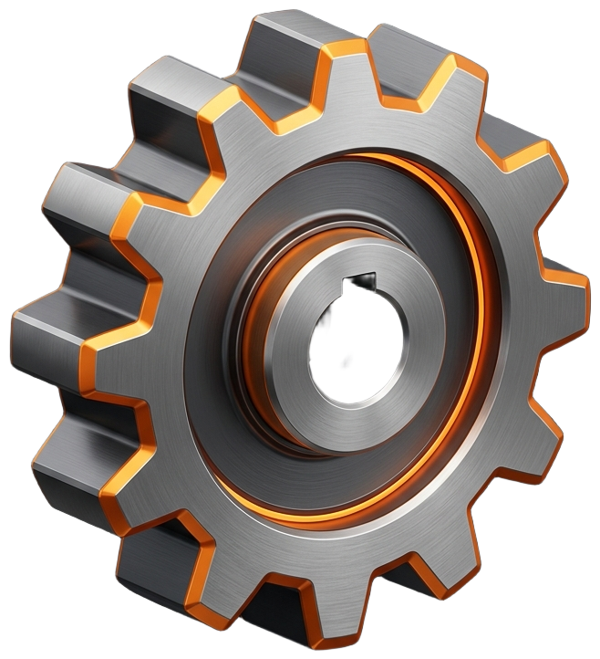

<p align="center">
  
</p>

<h1 align="center">⚙️ GearForge 3D</h1>

<p align="center">
  <strong>Parametrik 3D Yazıcı Dişli Tasarım &amp; Slicer Stüdyosu</strong><br>
  <em>Trunçgil Teknoloji © 2026 • Apple Design Mimarisi</em>
</p>

<p align="center">
  <a href="https://www.typescriptlang.org/"></a>
  <a href="https://threejs.org/"></a>
  <a href="https://vitejs.dev/"></a>
  <a href="https://vitest.dev/"></a>
  <a href="#mühendislik--matematiksel-altyapı"></a>
  <a href="#-su-geçirmez-watertight-2-manifold-mesh-garantisi"></a>
  <a href="LICENSE"></a>
</p>

**GearForge 3D**, doğrudan web tarayıcısı üzerinde çalışan; **ISO 21771** uluslararası evolvent standartlarına uygun, 3D yazıcılar ve FDM/SLA dilimleyiciler (Cura, PrusaSlicer, Bambu Studio, OrcaSlicer) için **%100 su geçirmez (watertight, 2-manifold) STL ve OBJ** üreten açık kaynaklı parametrik dişli modelleme ve kinematik simülasyon platformudur. Trunçgil'in radyal dilim geometrisinden ilham alan metalik gövde mimarisi ve Apple Human Interface Guidelines tasarım estetiği ile geliştirilmiştir.

---

## 🎯 Nedir Ne Değildir?

Mekanik tasarım ve 3D baskı dünyasında dişli üretimi çoğu zaman ya aşırı karmaşık CAD lisanslarına ya da dilimleyicide hata veren bozuk STL dosyalarına takılır. **GearForge 3D**, bu ayrımı netleştirmek için geliştirilmiştir:

| Konu | ✅ GearForge 3D **Nedir?** | ❌ GearForge 3D **Ne Değildir?** |
| :--- | :--- | :--- |
| **Model Doğruluğu** | Analitik kutupsal diferansiyel denklemlerle **ISO 21771 evolvent (involute)** eğrilerini milimetrik çözen bir mühendislik aracıdır. | Dişleri göz kararı yamuk, üçgen veya yay benzeri kaba şekillerle çizen basit bir görselleştirici **değildir**. |
| **3D Yazıcı Uyumu** | Dilimleyicilerde (Slicer) delik, ters normal veya non-manifold hatası vermeyen, **2-manifold kapalı ağ (mesh)** üreticisidir. | Boşluklu, ters yüzeyli (inverted face) ya da FDM dilimleyicide baskı hatası üreten kusurlu bir modelleme aracı **değildir**. |
| **Kurulum & Platform** | Sıfır kurulum gerektiren, doğrudan tarayıcıda çalışan ve **istemci taraflı (client-side)** koşan modern bir web uygulamasıdır. | GB'larca kurulum ve pahalı lisans gerektiren masaüstü CAD (SolidWorks, Inventor) yazılımlarının hantal bir kopyası **değildir**. |
| **Veri & Gizlilik** | %100 yereldir; tasarımlarınız, modelleriniz ve parametreleriniz asla uzak bir sunucuya gitmez, internet bağlantısı olmadan da çalışabilir. | Verilerinizi buluta yükleyen, üyelik veya abonelik dayatan bir bulut hizmeti **değildir**. |
| **Mekanik Fonksiyonellik** | NEMA step motor D-millerinden DIN 6885 kamalara, hafifletme kollarından çift helisel çavuş dişlilere kadar fonksiyonel montaj odaklıdır. | Sadece vitrinde dönen cansız veya mekanik montaj standardı olmayan dekoratif bir 3D model deposu **değildir**. |

---

## ✨ Öne Çıkan Yetenekler

### 1. Dişli Tipleri & Geometrik Formlar
- **Düz Dişli (Spur Gear):** Standart silindirik güç aktarım dişlisi.
- **Helisel Dişli (Helical Gear):** Sağ veya sol el açılı (0° - 45°), sessiz ve yüksek torklu aktarımlar.
- **Çavuş Dişli (Herringbone / Double Helical):** Eksenel yükleri kendi içinde nötrleyen, extruder ve hassas robotik mekanizmalar için çift yönlü helis.
- **Konik Eğimli Dişli (Bevel Taper Gear):** Yüzeye doğru daralan konik kavrama formları.
- **İç Dişli Çember (Internal Ring Gear):** Planet (epicyclic) redüktörler için içe bakan evolvent dişli gövdesi.

### 2. Boyutlandırma & Parametrik Esneklik
- **3 Farklı Boyutlandırma Modu:**
  - *Modül Modu:* Modül ($m$) ve Diş Sayısı ($z$) girilerek çaplar otomatik bulunur.
  - *Bölüm Dairesi Modu:* Hedef hatve çapı ($d$) ve diş sayısından modül hesaplanır.
  - *Dış Çap Modu:* Kullanılabilir fiziksel alana göre dış çap ($d_a$) girilerek sistem boyutlandırılır.
- **Profil Kaydırma ($x$):** Dipten kesilmeyi (undercut) önlemek veya merkez mesafesini ayarlamak için pozitif/negatif profil kaydırma katsayısı.
- **Kök Radyüsü ($r_f^*$) ve Diş Ucu Pahı:** Gerilme yığılmalarını azaltan dairesel kök geçişi ve FDM katman taşmalarını önleyen uç pahı.

### 3. Mil ve Merkez Delik Bağlantıları (Bore Coupling)
- **Tam Dolu (None):** Deliksiz masif gövde.
- **Standart Dairesel (Circular):** Rulman ve mil geçişleri.
- **D-Mil (D-Shaft - Tek Düzlük):** NEMA 14, 17, 23 step motor millerine doğrudan geçme.
- **Çift D-Mil (Double D):** Çift taraflı kilitli mil tasarımları.
- **Kama Kanalı (Keyway - DIN 6885):** Endüstriyel standart kama bağlantısı.
- **Altıgen Delik (Hexagonal):** M3 - M12 somun gömme veya altıgen mil yuvası.
- **Kare Delik (Square):** Kare profil miller.
- **Çok Kamalı / Yıldız (Spline):** 4 - 16 dişli yüksek torklu kamalı mil bağlantısı.

### 4. Gövde Tasarımı & Hafifletme (Web & Rim)
- **Dolu (Solid):** Maksimum dayanım.
- **Çökertmeli Gövde (Recessed Web):** Dış rim ve merkez göbek arasında inceltilmiş ağırlık tasarrufu sağlayan gövde.
- **Dairesel Hafifletme Delikleri (Lightening Holes):** Parametrik sayıda dairesel delikler.
- **Kollu / Jant Tipi (Spoked Gear):** Büyük dişlilerde minimum filament harcaması sağlayan taşıyıcı kollar.
- **Genişletilmiş Göbek (Hub Extension):** Üst ve alt yönde bağımsız ayarlanabilen setskur/vida tutucu göbek yükseltmeleri.

### 5. 3D Yazıcı Kalibrasyonu & Dayanım Analizi
- **Diş Boşluğu (Backlash):** FDM yazıcıların diş yan yüzeylerinde oluşturduğu sıkışmayı önleyen tolerans telafisi (0.00 - 0.80 mm).
- **İç Delik Toleransı (Bore Clearance):** Eriyik plastiğin içe çekmesini engelleyen radyal delik telafisi.
- **Filament & Ağırlık Tahmini:** PLA, PETG, ABS, ASA, Nylon PA12 ve TPU özkütleleri ile seçilen doluluk oranına (% infill) göre gramaj hesabı.

### 6. İnteraktif 3B Sahne & Görsel Araçlar
- **Gerçek Zamanlı Kinematik Simülasyon:** Eşleşen pinyon dişli (mating gear) ile ayarlanabilir RPM hızında dinamik dönme simülasyonu.
- **Kavrama Oranı Analizi:** Temas oranı ($\varepsilon_\alpha$), merkez mesafesi ve aktarım oranı göstergeleri.
- **Kesit İnceleme (Section Cut):** Diş profilini ve iç delik oturumunu içten keserek gösteren dinamik kesit düzlemi.
- **Referans Çemberleri:** Bölüm dairesi, taban dairesi, diş dibi ve dış çap referans halkaları.
- **Bölge Vurgulama (Zone HUD):** Dişli anatomisini (diş yanağı, dış rim, gövde, delik) renkli alt gruplarla canlı vurgulama.

### 7. Dışa Aktarım (Export) Formatları
- **Binary STL (.stl):** Bambu Studio, OrcaSlicer, PrusaSlicer ve Cura için ultra optimize, kompakt ikili format.
- **ASCII STL (.stl):** İnsan tarafından okunabilir metin tabanlı STL.
- **Wavefront OBJ (.obj):** Blender, Fusion 360 ve 3D CAD araçları için normalleri korunmuş poligon modeli.
- **Parametrik JSON (.json):** Tasarımı daha sonra yüklemek veya paylaşmak üzere JSON konfigürasyonu.

---

## 📐 Mühendislik & Matematiksel Altyapı

GearForge 3D, diş profillerini ve temas kinematiğini oluştururken analitik evolvent matematiğini kullanır:

#### 1. Involute (Evolvent) Fonksiyonu
Kavrama açısı $\alpha$ olan bir diş profili için evolvent polar açısı:

```math
\text{inv}(\alpha) = \tan(\alpha) - \alpha
```

#### 2. Taban Dairesi Yarıçapı ($r_b$)
Bölüm dairesi yarıçapı $r$ ve kavrama açısı $\alpha$ cinsinden:

```math
r_b = r \cdot \cos(\alpha) = \frac{m \cdot z}{2} \cdot \cos(\alpha)
```

#### 3. Kutup Koordinatlarında Evolvent Parametrik Denklemi
Hadve açısı $\varphi$ parametresine bağlı yarıçap $r(\varphi)$ ve açı $\theta(\varphi)$:

```math
\begin{aligned}
r(\varphi) &= r_b \cdot \sqrt{1 + \varphi^2} \\
\theta(\varphi) &= \varphi - \arctan(\varphi)
\end{aligned}
```

#### 4. Dipten Kesilmeyi (Undercut) Önleyen Minimum Diş Sayısı ($z_{\min}$)
Profil kaydırma katsayısı $x$ ve diş üstü faktörü $h_a$ dikkate alındığında:

```math
z_{\min} = \left\lceil \frac{2 \cdot h_a^* \cdot (1 - x)}{\sin^2(\alpha)} \right\rceil
```

#### 5. Eşleşen Dişli Kavrama Oranı (Contact Ratio - $\varepsilon_\alpha$)
Sürekli ve titreşimsiz güç aktarımı için temas oranı $\varepsilon_\alpha \ge 1.20$ olmalıdır:

```math
\varepsilon_\alpha = \frac{\sqrt{r_{a1}^2 - r_{b1}^2} + \sqrt{r_{a2}^2 - r_{b2}^2} - a \cdot \sin(\alpha)}{p_b}
```

> **Not:** Burada $a$ eksenler arası merkez mesafesi, $p_b = \pi \cdot m \cdot \cos(\alpha)$ ise temel adımdır.


### 🛡️ Su Geçirmez (Watertight / 2-Manifold) Mesh Garantisi
3D dilimleme yazılımlarının katman hatası vermemesi için geometrinin Euler karakteristiği ve topolojik kapalı yüzey kuralı sağlanmalıdır:

1. **Sıfır Açık Kenar (Zero Boundary Edges):** Her üçgen kenarı tam olarak komşu iki üçgen tarafından paylaşılır.
2. **Sıfır Tekil Nokta (Non-manifold Vertices):** Bir köşede iki ayrı hacim temas etmez.
3. **Tutarlı Yüzey Normalleri:** Tüm yüzey normalleri dışa bakar, dilimleyici gövde içini ve dışını net bir şekilde ayırır.

---

## 🏗️ Yazılım Mimarisi (Clean Architecture)

Proje, kurumsal yazılım standartlarına, **Clean Architecture** ve **SOLID** tasarım prensiplerine uygun olarak 4 katmanda kurgulanmıştır:

```text
gearforge/
├── .github/
│   └── workflows/
│       └── deploy.yml          # GitHub Pages otomatik dağıtım iş akışı
├── src/
│   ├── domain/                 # Tamamen izole iş ve matematik kuralları
│   │   ├── calculators/        # ISO 21771 evolvent ve metrik hesaplayıcılar
│   │   ├── mesh/               # 2-Manifold su geçirmez 3B ağ üreticisi
│   │   ├── models/             # Tip tanımları, arayüzler ve veri modelleri
│   │   ├── presets/            # Hazır mekanik dişli şablonları deposu
│   │   └── profiles/           # Delik, gövde ve diş profili üreteçleri
│   ├── application/            # Durum yönetimi ve olay koordinasyonu
│   │   └── GearBuilderStore.ts # Merkezi reaktif State Store (Pub/Sub)
│   ├── infrastructure/         # Dış dünya ve donanım entegrasyonu
│   │   ├── exporters/          # Binary/ASCII STL, OBJ, JSON dışa aktarıcılar
│   │   └── three/              # Three.js WebGL motoru, ışıklandırma ve kamera
│   ├── presentation/           # Kullanıcı arayüzü ve bileşenler
│   │   ├── components/         # Parametre paneli, metrikler, araç çubuğu
│   │   └── styles/             # Modern endüstriyel karanlık tema (CSS)
│   └── main.ts                 # Composition Root (Dependency Injection)
├── dist/                       # Üretim derlemesi (Production bundle)
├── Dockerfile                  # Konteyner dağıtımı (Nginx tabanlı)
├── nginx.conf                  # Nginx önbellekleme ve gzip yapılandırması
├── vite.config.ts              # Vite derleyici ve bağıl yol yapılandırması
└── package.json
```

---

## 🚀 Nasıl Deploy Edilir? (Dağıtım Rehberi)

GearForge 3D, **tamamen istemci taraflı (client-side static)** bir web uygulamasıdır. Backend veritabanı veya sunucu tarafı çalıştırma ortamı gerektirmez. `npm run build` komutunun ürettiği `dist/` klasörü her türlü statik sunucuda çalışır.

### Seçenek 1: GitHub Pages (Önerilen & Otomatik)
Projeye hazır bir [GitHub Actions Workflow](file:///.github/workflows/deploy.yml) eklenmiştir.

1. Kodunuzu GitHub deposuna gönderin:
   ```bash
   git push origin main
   ```
2. GitHub deponuzun **Settings > Pages** sekmesine gidin.
3. **Build and deployment > Source** seçeneğini **GitHub Actions** olarak ayarlayın.
4. `.github/workflows/deploy.yml` otomatik çalışacak ve uygulamanızı şu adreste yayınlayacaktır:
   `https://<kullanici-adiniz>.github.io/<repo-adiniz>/`

---

### Seçenek 2: Vercel ile Dağıtım (Tek Tıkla)
Vercel CLI kullanarak veya GitHub reponuzu bağlayarak saniyeler içinde deploy edebilirsiniz:

```bash
# Vercel CLI yüklü ise:
npx vercel
```
* **Build Command:** `npm run build`
* **Output Directory:** `dist`

---

### Seçenek 3: Netlify ile Dağıtım
Netlify CLI ile doğrudan yayınlamak için:

```bash
# Projeyi derleyin
npm run build

# Netlify'a gönderin
npx netlify deploy --prod --dir=dist
```
Veya Netlify web kontrol panelinden `dist` klasörünü sürükleyip bırakabilirsiniz.

---

### Seçenek 4: Cloudflare Pages
1. Cloudflare Dashboard > **Workers & Pages** > **Create application** > **Pages** yolunu izleyin.
2. GitHub reponuzu bağlayın.
3. Yapılandırma ayarlarını girin:
   - **Framework preset:** `Vite`
   - **Build command:** `npm run build`
   - **Build output directory:** `dist`
4. **Save and Deploy** butonuna tıklayın.

---

### Seçenek 5: Docker & Nginx ile Kendi Sunucunuzda (VPS / On-Premise)
Projeyle birlikte gelen optimize çok aşamalı [Dockerfile](file:///Dockerfile) ve [nginx.conf](file:///nginx.conf) sayesinde tek komutla container ayağa kaldırabilirsiniz:

```bash
# 1. Docker imajını oluşturun
docker build -t gearforge-3d .

# 2. Konteyneri 8080 portunda çalıştırın
docker run -d -p 8080:80 --name gearforge gearforge-3d
```
Artık tarayıcınızdan `http://localhost:8080` adresine gidebilirsiniz.

---

### Seçenek 6: Geleneksel Web Sunucusu (Apache, Nginx, cPanel)
1. Yerel makinenizde projeyi derleyin:
   ```bash
   npm run build
   ```
2. Oluşan `dist/` klasörünün içindeki tüm dosyaları FTP/SCP ile sunucunuzun `public_html` veya `/var/www/html` dizinine yükleyin.
3. `vite.config.ts` içinde `base: './'` tanımlı olduğu için dosyalar herhangi bir alt dizinde dahi sorunsuz çalışacaktır.

---

## 💻 Yerel Geliştirme (Local Development)

### Gereksinimler
- [Node.js](https://nodejs.org/) v18.0 veya üzeri
- `npm` (Node ile birlikte gelir)

### Adımlar

1. Depoyu klonlayın ve klasöre girin:
   ```bash
   git clone https://github.com/umitunc/gearforge.git
   cd gearforge
   ```

2. Bağımlılıkları yükleyin:
   ```bash
   npm install
   ```

3. Geliştirme sunucusunu başlatın:
   ```bash
   npm run dev
   ```
   Terminalde görüntülenen adrese (genellikle `http://localhost:5173`) gidin. Hot-reload aktiftir; kod değişiklikleri anında tarayıcıya yansır.

4. Birim testlerini çalıştırın:
   ```bash
   npm test
   ```

5. Üretim derlemesi (Production Build) alın:
   ```bash
   npm run build
   ```

6. Derlenmiş paketi yerelde test edin:
   ```bash
   npm run preview
   ```

---

## 🖨️ 3D Yazıcı & Dilimleyici (Slicer) İpuçları

Dişlilerinizin pürüzsüz dönmesi ve kırılmaması için dilimleyicinizde (Cura, Bambu Studio, OrcaSlicer, PrusaSlicer) şu ayarları uygulamanız önerilir:

| Ayar | FDM (Filament) Önerisi | SLA (Reçine) Önerisi | Açıklama |
| :--- | :--- | :--- | :--- |
| **Katman Yüksekliği** | 0.12 mm – 0.16 mm | 0.05 mm | Diş profilinin pürüzsüz evolvent formunu koruması için ince katman tercih edin. |
| **Duvar Sayısı (Wall Loops)** | 4 – 6 Duvar | N/A | Dişlerin mukavemeti doluluktan ziyade duvar sayısından gelir. Dişlerin içi tamamen duvardan oluşmalıdır. |
| **Doluluk Oranı (Infill)** | %30 – %50 (Gyroid) | Masif / %100 | Darbe emilimi ve tork direnci için Gyroid deseni önerilir. |
| **Backlash (Diş Boşluğu)** | 0.15 mm – 0.25 mm | 0.05 mm – 0.10 mm | Dişlerin birbirini sıkıştırmaması için GearForge arayüzündeki Backlash değerini yazıcınızın hassasiyetine göre verin. |
| **Bore Clearance** | 0.10 mm – 0.20 mm | 0.05 mm | Milin deliğe rahatça girmesi için GearForge'daki iç delik telafisini kullanın. |
| **Baskı Yönü** | Düz yüzey tablaya paralel | Tablaya 30°-45° açılı | Dişli ekseni Z eksenine paralel olacak şekilde düz basılmalıdır; böylece katman çizgileri diş torkuna dik kalır. |

---

## 🤝 Katkıda Bulunma

1. Bu depoyu Fork'layın (`fork`).
2. Yeni özellik dalı (feature branch) oluşturun: `git checkout -b ozellik/yeni-delik-profili`
3. Değişikliklerinizi commit edin: `git commit -m 'feat: Altıgen kama deliği eklendi'`
4. Dalınızı uzak depoya gönderin: `git push origin ozellik/yeni-delik-profili`
5. Bir **Pull Request** açın.

---

## 🍊 Telif & Sürüm Bilgisi (Credits)

* **Geliştirici & Telif Sahibi:** Trunçgil Teknoloji © 2026
* **Versiyon Kodu:** `v1.0.4-cad` (Release)
* **Yapı Kimliği (Build ID):** `2026.10.14-r170`
* **Geometri Motoru:** ISO 21771 Analitik Evolvent Matematik Çekirdeği
* **3B Görselleştirme:** Three.js r170 (WebGL 2.0)
* **Mimari Standart:** SOLID Prensipleri & %100 Su Geçirmez (Watertight 2-Manifold) STL Üreteci
* **Tasarım Dili:** Apple Human Interface Guidelines & Trunçgil Narenciye Teması

---

## 📄 Lisans

Bu proje [MIT Lisansı](LICENSE) kapsamında lisanslanmıştır. Ticari ve kişisel projelerinizde dilediğiniz gibi kullanabilir, değiştirebilir ve dağıtabilirsiniz.

